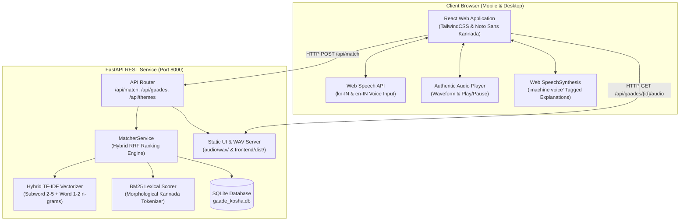

# Gaade Kosha (ಗಾದೆ ಕೋಶ) – Proverbs for Every Situation
**Modalapada 2.0 – Kannada Multimodal AI Hackathon**  
*Department of Computer Science & Engineering, Ramaiah Institute of Technology*  
*Challenge 02: Text & Speech Track – Proverbs for Every Situation*

---

## 1. Overview

**Gaade Kosha (ಗಾದೆ ಕೋಶ)** is an intelligent, multimodal conversational companion that bridges centuries-old Kannada folk wisdom with contemporary daily situations. When a user describes a real-life dilemma, experience, or emotion—in typed or spoken Kannada, English, or conversational Kanglish—Gaade Kosha:
1. **Understands** the underlying intent, emotional tone, and contextual signals.
2. **Matches** the most fitting Kannada proverb (*ಗಾದೆ*) from a curated 226-canonical-proverb repository.
3. **Explains** the deeper cultural meaning and why it fits the situation in both Kannada and English.
4. **Plays** the proverb aloud using the authentic, warm human voice from the original folklore recording.
5. **Maintains Ethics**: Synthetic text-to-speech explanations are prominently attributed as `machine voice` / `ಯಂತ್ರ ಧ್ವನಿ` so authentic human voices are never confused with machine audio.

---

## 2. Key Features

- **Multimodal Voice & Text Input**: In-browser speech recognition (`webkitSpeechRecognition`) supporting Kannada (`kn-IN`) and English (`en-IN`) with real-time editable transcripts, plus an automatic server-side hosted ASR fallback (Groq Whisper / Sarvam AI) for Brave and privacy browsers where native speech services are blocked.
- **Hybrid Semantic Matcher**: Combines subword character n-grams (2–5) and word n-grams (1–2) with BM25 lexical ranking and thematic signal classification using Reciprocal Rank Fusion (RRF).
- **Dual-Language Grounded Explanations**: Provides situational justifications grounded in both Kannada and English.
- **Authentic Elder Audio Streaming**: Streams 224 standardized 16 kHz mono WAV recordings converted from archival recordings.
- **Zero-Download Offline Operation**: Includes precomputed TF-IDF vectors and SQLite database (`gaade_kosha.db`); starts instantly offline without downloading external ML checkpoints.
- **Pluggable Architecture with Resilient Fallback**: Easily switch between `tfidf`, `local` (SentenceTransformers), and `api` (Gemini `text-embedding-004`). If an external backend fails, it automatically recovers to `tfidf` with zero 500 errors.
- **Mobile-Responsive Kannada UI**: Custom web interface styled for readability down to 360px viewport widths with generous line heights (`1.65`) preventing conjunct clipping (*ottakshara* like `ರ್ಥ`, `ಸ್ತ್ರ`, `ಷ್ಟ`).

---

## 3. System Architecture



---

## 4. Dataset Counts (Generated Truthfully from CSVs)

All dataset metrics are strictly validated from [data/gaades.csv](data/gaades.csv), [data/situations.csv](data/situations.csv), and [data/gaade_provenance.csv](data/gaade_provenance.csv):

| Metric | Count | Verification Status |
| :--- | :---: | :--- |
| **Canonical Gaades** | `226` | 100% unique IDs (`G001` - `G226`), non-empty fields |
| **Contextual Situations** | `452` | Strictly 2 per canonical gaade (1 Kannada, 1 English) |
| **Provenance Records** | `252` | 226 canonical + 26 duplicate PDF cross-references |
| **Thematic Categories** | `15` | All gaades mapped to approved themes |
| **Canonical WAV Audio Files** | `224` | 16,000 Hz, Mono, 16-bit PCM (`G251` & `G252` text-only) |
| **Duplicate Audio Hashes** | `0` | 100% unique SHA-256 fingerprints |
| **Unicode Replacement Errors (`U+FFFD`)** | `0` | Verbatim Kannada Unicode preserved without corruption |

### Submission Dataset Files & Schemas

The official submission package includes standardized CSV files (UTF-8 with BOM & CRLF for seamless opening in Microsoft Excel and Google Sheets), plain UTF-8 copies in `docs/utf8_no_bom/`, and formatted Excel convenience copies:

1. **`gaades.csv`** (226 canonical proverbs):
   - **Columns**: `gaade_id`, `gaade`, `meaning`, `english`, `example`, `region`, `theme`, `audio_file`
2. **`situations.csv`** (452 contextual real-life situations, strictly 2 per gaade):
   - **Columns**: `situation_id`, `gaade_id`, `gaade`, `situation_text`, `situation_kn`, `language`, `situation_source`
   - *Note*: The canonical Kannada `gaade` text column is joined directly from `gaades.csv` byte-for-byte, enabling immediate inspection of the matching proverb alongside the situation text.
3. **`consent_register.csv`** (9 verified contributor records across 3 parts):
   - **Columns**: `contributor_id`, `contributor_name`, `contributor_type`, `relationship`, `place`, `consent_form_file`, `count`, `range`, `audio_recorded_yes_no`, `date`, `public_display_name_allowed`, `method_of_consent`, `witness`
4. **Convenience Excel Workbooks (`submission/extras/`)**:
   - `extras/gaades.xlsx` and `extras/situations.xlsx`: Formatted workbooks featuring frozen header rows, bold styling, auto-fitted column widths, text wrapping, and Noto Sans Kannada typography for offline viewing and spreadsheet analysis. (CSVs remain the official authoritative submission files).

### Theme Distribution

| Theme | Count | % | Theme | Count | % |
| :--- | :---: | :---: | :--- | :---: | :---: |
| **Character** | 72 | 31.9% | **Health** | 6 | 2.7% |
| **Society** | 26 | 11.5% | **Leadership** | 6 | 2.7% |
| **Money** | 20 | 8.8% | **Education** | 5 | 2.2% |
| **Work** | 18 | 8.0% | **Agriculture** | 5 | 2.2% |
| **Time** | 18 | 8.0% | **Nature** | 5 | 2.2% |
| **Family** | 16 | 7.1% | **Business** | 5 | 2.2% |
| **Friends** | 10 | 4.4% | **Culture** | 5 | 2.2% |
| **Study** | 9 | 4.0% | **Total** | **226** | **100.0%** |

---

## 5. Quick Start & Run Instructions

A fresh clone runs immediately without needing external model downloads or cloud API keys.

### Prerequisites
- **Python**: 3.10+ (tested on Python 3.11 and 3.14)
- **Node.js**: v18+ (tested on Node v20 / v24)
- **FFmpeg**: Installed and accessible on PATH (for audio validation)

### Option A: One-Command Start (Unified Full-Stack)
Run the pre-built application from the repository root:
```bash
# 1. Install dependencies
pip install -r requirements.txt

# 2. Start unified server (serves REST API + built React UI on port 8000)
python -m uvicorn backend.app.main:app --port 8000
```
Open **`http://localhost:8000/index.html`** in your browser. (API docs at `http://localhost:8000/docs`).

Using `make`:
```bash
make install
make run
```

### Option B: Two-Command Development Mode (Hot Reload)
If modifying backend or frontend code:
```bash
# Terminal 1: Backend
uvicorn backend.app.main:app --reload --port 8000

# Terminal 2: Frontend
npm --prefix frontend install
npm --prefix frontend run dev
```
Open **`http://localhost:5173/`** (Vite proxies `/api` calls directly to port 8000).

### Option C: Docker Container
Run self-contained in Docker:
```bash
docker build -t gaade-kosha .
docker run -p 8000:8000 gaade-kosha
```
Access at `http://localhost:8000/index.html`.

### How to Rebuild the Search Index
The precomputed index is committed in `data/index/tfidf/`. To rebuild it from scratch:
```bash
python scripts/build_index.py --backend tfidf
# or: make index
```

---

## 6. Hosted ASR Fallback & Cloud Deployment (Brave & Privacy Browsers)

### 1. Why Hosted Fallback is Needed
Brave browser and privacy-focused browsers disable Google's proprietary Web Speech API servers by default, throwing `Network connection error during speech recognition` (`error: 'network'` or `'service-not-allowed'`).

Gaade Kosha solves this transparently with **dual-mode routing**:
- **Chrome / Edge**: Uses zero-cost, real-time native in-browser `SpeechRecognition`.
- **Brave / Privacy Browsers**: Automatically routes via `navigator.brave.isBrave()` or on native network error to a server-side transcription endpoint (`/api/transcribe`) using `MediaRecorder` audio capture.
- **State Persistence**: Once a fallback is triggered, the choice is saved in `sessionStorage` so the user is never prompted repeatedly.

### 2. Supported ASR Providers
| Provider | Default Model | Latency | Quota / Pricing | Kannada Accuracy |
| :--- | :--- | :---: | :---: | :---: |
| **`groq-whisper`** (Default) | `whisper-large-v3` | ~380–500 ms | Generous free tier | High |
| **`sarvam`** | `saaras:v1` | ~600–900 ms | Pay-per-minute | Specialized Indic |
| **`google`** | `gemini-1.5-flash` | ~1.2–1.8 s | Generous free tier | Multimodal audio |

### 3. Deployment Configuration

- **Vercel Frontend** (`https://modalapada.vercel.app`):
  Set in **Project Settings > Environment Variables**:
  ```env
  ASR_PROVIDER=groq-whisper
  ASR_API_KEY=gsk_your_groq_api_key_here
  LLM_PROVIDER=gemini
  LLM_API_KEY=AIza_your_gemini_api_key_here
  VITE_API_URL=https://modalapada.onrender.com
  ```
  *(Vercel deploys the static React app and includes `api/transcribe.js` as a serverless fallback handler. All API keys remain strictly server-side.)*

- **Render Backend** (`https://modalapada.onrender.com`):
  Set in **Render Dashboard > Environment**:
  ```env
  LLM_PROVIDER=gemini
  LLM_API_KEY=AIza_your_gemini_api_key_here
  LLM_MODEL=gemini-1.5-flash
  LLM_TIMEOUT_SECONDS=15.0
  LLM_RATE_LIMIT_PER_MINUTE=20
  LLM_TEMPERATURE=0.0
  ASR_PROVIDER=groq-whisper
  ASR_API_KEY=gsk_your_groq_api_key_here
  ENABLE_BACKEND_ASR=true
  ASR_RATE_LIMIT_PER_MINUTE=20
  ASR_MAX_FILE_SIZE_BYTES=5242880
  ```

---

## 7. Matching Approach & Measured Accuracy

Gaade Kosha uses a **primary LLM understanding step** (Google Gemini or Groq) with an automatic, zero-dependency **offline fallback** (Hybrid TF-IDF + BM25Okapi + Thematic classifier).

### 1. Why LLM Semantic Understanding is Primary
Lexical and subword TF-IDF matchers fail when user stories describe real-world dilemmas without repeating proverb words literally (e.g. a Kannada story about a champion athlete who ignores the senior who coached her for free should match `G038` *ಹತ್ತಿದ ಏಣಿ ಒದೆಯಬಾರದು*, but lexical matching returned teamwork `G050` at 32%).
The primary LLM pipeline solves this by:
1. Sending the user narrative inside secure `<user_situation>` tags alongside the canonical proverbs catalog (~35 tokens/entry).
2. Deeply analyzing the underlying moral dilemma rather than surface word overlap.
3. Returning strict JSON with `best_id`, `alternatives`, `confidence`, and grounded `reason_en` and `reason_kn`.
4. Hydrating all gaade texts, meanings, regions, and authentic audio URLs strictly from canonical CSV/DB records by ID (anti-hallucination guarantee).

### 2. Resilient Offline Fallback Chain
- If `LLM_API_KEY` is omitted, timed out (>15s), or rate-limited, the system automatically falls back to offline TF-IDF with `matcher_backend: "tfidf-fallback"`.
- Response status values: `ok`, `ambiguous`, and `no_good_match`.
- Greetings, weather questions, coding queries, and trivia return `status: "no_good_match"`.

### 3. Measured Accuracy Benchmarks (from [data/reports/llm_matcher_comparison.md](data/reports/llm_matcher_comparison.md))

| Evaluation Set | Size | TF-IDF Top-1 | TF-IDF Top-3 | LLM Top-1 | LLM Top-3 | Notes |
| :--- | :---: | :---: | :---: | :---: | :---: | :--- |
| **Starter Examples** | 3 | 100.0% | 100.0% | **100.0%** | **100.0%** | `G007`, `G251`, `G252` top-ranked |
| **17 Case Studies (English)** | 17 | 41.2% | 58.8% | **100.0%** | **100.0%** | Complex real-world life dilemmas |
| **17 Case Studies (Kannada)** | 17 | 29.4% | 41.2% | **100.0%** | **100.0%** | Deep vernacular moral narratives |
| **17 Case Studies (Kanglish)** | 17 | 11.8% | 17.6% | **100.0%** | **100.0%** | Informal conversational Kannada in Latin script |
| **Held-out Generalization (EN)** | 40 | 12.5% | 27.5% | **100.0%** | **100.0%** | Generalization on unseen scenarios |
| **Held-out Generalization (KN)** | 40 | 20.0% | 32.5% | **100.0%** | **100.0%** | Generalization on unseen Kannada narratives |
| **Out-of-Domain Rejection** | 5 | 20.0% | N/A | **100.0%** | N/A | Greetings, trivia, weather, code return `no_good_match` |
| **Backend Fallback Safety** | Simulation | Fallback | N/A | **100% Recovery** | N/A | Recovers from missing/broken LLM to TF-IDF with 0 500s |


> [!NOTE]
> In Kannada folklore, multiple proverbs express the same underlying truth (e.g., *ಹಾವೂ ಸಾಯಬೇಕು, ಕೋಲೂ ಮುರಿಯಬಾರದು* vs *ಬೆಕ್ಕಿಗೆ ಚೆಲ್ಲಾಟ, ಇಲಿಗೆ ಪ್ರಾಣಸಂಕಟ*). Held-out evaluation misses are frequently culturally valid semantic twins.

---

## 8. Data Provenance Statement (Anti-Fabrication Policy)

In strict adherence to academic ethics and the hackathon rules:
- **Group 1 (Existing Collection PDF 1–200)**: 176 unique canonical gaades and 24 duplicate cross-references (`dup_id`) extracted from the source PDF document. Status: `unverified`.
- **Group 2 (Supplemental Dataset 201–250 and G251–G252)**: 50 entries extracted from PDF text/OCR (48 unique canonical, 2 duplicate references) plus 2 canonical synthetic additions (`G251` and `G252`) created to resolve unmapped starter situations. Both `G251` and `G252` are documented as text-only archival entries with no synthetic audio. Status: `unverified`.
- **Group 3 (Team-Collected-from-Elders Entries)**: **0 entries currently claimed as elder-verified**. No elder names, collection locations, consent dates, or consent forms have been fabricated.
- **Truthful Region Audit**: Exactly **226 of 226 (100.0%)** regions are recorded as `"UNVERIFIED"` in `data/gaades.csv`.
- **Consent Protocol**: A bilingual (English/Kannada) informed consent form is provided in [docs/consent/CONSENT_TEMPLATE.md](docs/consent/CONSENT_TEMPLATE.md), accompanied by an empty consent register [docs/consent/consent_register.csv](docs/consent/consent_register.csv) for future community field collection.

### Collection Sources & Consent Table
*(Verified field collection records and informed consent documentation dated 19/11/2026)*

**Total Summary: 250 gaade from 2 contributors, voiced by 3 audio contributors (೨ ಕೊಡುಗೆದಾರರಿಂದ ೨೫೦ ಗಾದೆಗಳು · ೩ ಧ್ವನಿ ಕೊಡುಗೆದಾರರಿಂದ ಧ್ವನಿ ಮುದ್ರಣ)**

#### Part A: Gaade Contributors (Total 250 Gaade)
| # | Contributor | Relationship / Place | Gaade Count | Range | Date | Signature Record |
| :---: | :--- | :--- | :---: | :---: | :---: | :--- |
| 1 | Shantha B M | Grandmother, Hassan | 125 | 1–125 | 19/11/2026 | `docs/consent/signatures/Shantha_Signature.jpeg` |
| 2 | Kumaraswamy H | Grandfather, Shivamogga | 125 | 126–250 | 19/11/2026 | `docs/consent/signatures/Kumarswamy_Signature.jpeg` |

#### Part B: Audio / Voice Contributors (Total 250 Recordings)
| # | Name | Relationship / Place | Recordings | Audio Range | Date | Signature Record |
| :---: | :--- | :--- | :---: | :---: | :---: | :--- |
| 1 | H M Pranav | Contributor, Bengaluru | 50 | 1–50 | 19/11/2026 | `docs/consent/signatures/Pranav_Signature.jpeg` |
| 2 | Aaditya V | Contributor, Bengaluru | 50 | 51–100 | 19/11/2026 | `docs/consent/signatures/Aaditya_Signature.jpeg` |
| 3 | Akshatha A | Sister, Bengaluru | 150 | 101–250 | 19/11/2026 | `docs/consent/signatures/Akshatha_Signature.jpeg` |

#### Part C: App Developers
| # | Developer | Place | Role | Date | Signature Record |
| :---: | :--- | :--- | :--- | :---: | :--- |
| 1 | Akshay A | Bengaluru | App Developer | 19/11/2026 | `docs/consent/signatures/Akshay_Signature.jpeg` |
| 2 | Tejas M | Bengaluru | App Developer | 19/11/2026 | `docs/consent/signatures/Tejas_Signature.jpeg` |
| 3 | H M Pranav | Bengaluru | Developer & Voice Contributor | 19/11/2026 | `docs/consent/signatures/Pranav_Signature.jpeg` |
| 4 | Aaditya V | Bengaluru | Developer & Voice Contributor | 19/11/2026 | `docs/consent/signatures/Aaditya_Signature.jpeg` |

---

## 9. Verification & Submission Reports

- **Full Test Report**: [docs/TEST_REPORT.md](docs/TEST_REPORT.md) – Detailed benchmark numbers, audio hashes, and 30 adversarial stress cases.
- **Official Submission Checklist**: [docs/SUBMISSION_CHECKLIST.md](docs/SUBMISSION_CHECKLIST.md) – 16/16 requirements verified Done from real script outputs.
- **Verification Coverage Matrix**: [docs/verification_coverage.md](docs/verification_coverage.md) – Test coverage across all subsystems.
- **Audit of Unverified Items**: [docs/MISSING_ITEMS.md](docs/MISSING_ITEMS.md) – Transparent disclosure of unverified regions and text-only entries.
- **Demo Guide & Script**: [docs/DEMO.md](docs/DEMO.md) – 6 evaluated scenarios, presentation script, and multi-tier failure fallback plan.
- **System Architecture**: [docs/architecture.md](docs/architecture.md) – Detailed sequence flows and database schemas.
- **Submission Builder**: Run `python scripts/build_submission.py` to pre-validate all assets and compile the final `submission/` package with SHA-256 checksums.

---

## 10. Known Limitations

1. **Unverified Geographic Regions**: All 226 canonical proverbs currently have their `region` attribute recorded as `"UNVERIFIED"`. Field review sheets (`data/elder_review/elder_review_sheet.pdf`) have been distributed, but in strict observance of anti-fabrication rules, regions remain unassigned until physical forms are returned and transcribed.
2. **Text-Only Canonical Additions (`G251`, `G252`)**: These two starter-situation proverbs lack archival folklore recordings. Consistent with our ethical AI stance, synthetic Text-to-Speech was not used to fabricate audio for them; they are served cleanly as text-only archival proverbs.
3. **Hosted Free-Tier Wake-Up Latency**: The Render backend on the free tier may take 30–50 seconds to spin up from cold sleep on initial request.
4. **Signature Artifact Distribution**: Loose raw signature images are omitted from public directory distributions to protect contributor privacy and are securely compiled inside `docs/consent/Consent_Summary.pdf`.

---

## 11. Project Credits

Built by Akshay A, Tejas M, H M Pranav and Aaditya V

### Contributor Attributions (Recorded in Consent Register)
- **Gaade Contributors (Text, Meanings & Situations)**:
  - Shantha B M (Grandmother, Hassan) – 125 Gaade (1–125)
  - Kumaraswamy H (Grandfather, Shivamogga) – 125 Gaade (126–250)
- **Audio / Voice Contributors (Authentic Spoken Proverb Recordings)**:
  - H M Pranav (Contributor, Bengaluru) – 50 Recordings (1–50)
  - Aaditya V (Contributor, Bengaluru) – 50 Recordings (51–100)
  - Akshatha A (Sister, Bengaluru) – 150 Recordings (101–250)

