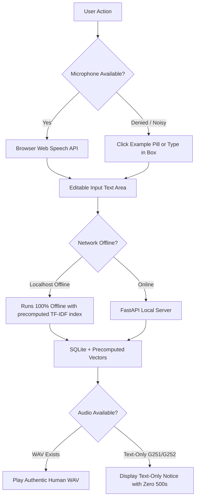

# Gaade Kosha (ಗಾದೆ ಕೋಶ) – Demo Guide & Presentation Script
**Modalapada 2.0 – Kannada Multimodal AI Hackathon**  
*Department of Computer Science & Engineering, Ramaiah Institute of Technology*  
*Challenge 02: Text & Speech Track – Proverbs for Every Situation*

---

## 1. Demo Overview

Gaade Kosha connects contemporary real-life situations with centuries-old Kannada folk wisdom (*ಗಾದೆಗಳು*). When a user types or speaks a situation (in Kannada, English, or conversational Kanglish), the multimodal engine:
1. Detects language and extracts contextual semantic signals.
2. Matches the optimal proverb using hybrid retrieval (TF-IDF subword n-grams + BM25 + thematic signals).
3. Provides grounded explanations in both Kannada and English explaining *why* the proverb fits.
4. Streams the authentic, original human voice recording of the proverb.
5. Clearly attributes any synthetic text-to-speech explanations as `machine voice` / `ಯಂತ್ರ ಧ್ವನಿ`.

---

## 2. Six Evaluated Demo Scenarios

The system has been pre-tested on the following 6 scenarios spanning official starters, colloquial Kannada, conversational Kanglish, and adversarial out-of-domain edge cases.

### Scenario 1: The Pretend Helper (Official Starter 1)
- **Input Text / Voice**:  
  `"Someone who pretends to help but actually hurts"`
- **Language**: English
- **Matched Gaade**: `G007`
- **Kannada Text**: **ಆಡಿಸು ಕಾಲಲ್ಲಿ, ತುಳಿಸು ಬೆನ್ನಲ್ಲಿ**
- **Transliteration**: *Aadisu kaalalli, tulisu bennalli*
- **Theme**: Character / Betrayal
- **Meaning (Kannada)**: ಮುಖದ ಮುಂದೆ ಪ್ರೀತಿ ತೋರುತ್ತಾ, ಬೆನ್ನ ಹಿಂದೆ ಕೇಡು ಬಯಸುವ ಕಪಟ ನಡವಳಿಕೆ.
- **Meaning (English)**: Rocking the cradle with the foot while crushing the back. Refers to deceptive people who act friendly while secretly causing harm.
- **Why It Fits**: The user described feigned assistance hiding malice. The proverb directly exposes two-faced betrayal.
- **Audio Output**: Streams original authentic human recording `audio/wav/G007.wav`.

---

### Scenario 2: Diligence & Ultimate Success (Official Starter 2)
- **Input Text / Voice**:  
  `"Hard work brings good results eventually"`
- **Language**: English
- **Matched Gaade**: `G251`
- **Kannada Text**: **ಆಳಾಗಿ ದುಡಿ, ಅರಸನಾಗಿ ಉಣ್ಣು**
- **Transliteration**: *Aalaagi dudi, arasanaagi unnu*
- **Theme**: Work / Diligence
- **Meaning (Kannada)**: ಆರಂಭದಲ್ಲಿ ಸೇವಕನಂತೆ ಕಷ್ಟಪಟ್ಟು ದುಡಿದರೆ ಮುಂದೆ ರಾಜನಂತೆ ವೈಭವದಿಂದ ಬದುಕಬಹುದು.
- **Meaning (English)**: Work as a servant first, then feast like a king. Diligence and humble labor lead to lasting prosperity.
- **Why It Fits**: Directly aligns with the virtue of tireless effort yielding future rewards.
- **Audio Output**: Text-only canonical entry. Audio player gracefully informs: *"No audio recording available for this proverb (Text-only archival entry)"*.

---

### Scenario 3: Financial Prudence (Official Starter 3)
- **Input Text / Voice**:  
  `"Live within your financial means"`
- **Language**: English
- **Matched Gaade**: `G252`
- **Kannada Text**: **ಹಾಸಿಗೆ ಇದ್ದಷ್ಟು ಕಾಲು ಚಾಚು**
- **Transliteration**: *Haasige iddashtu kaalu chaachu*
- **Theme**: Money / Prudence
- **Meaning (Kannada)**: ನಮ್ಮ ಆದಾಯ ಅಥವಾ ಸಾಮರ್ಥ್ಯಕ್ಕೆ ತಕ್ಕಂತೆ ಮಾತ್ರ ಖರ್ಚು ಮಾಡಬೇಕು.
- **Meaning (English)**: Stretch your legs only as far as your mattress reaches. Live strictly within your earnings.
- **Why It Fits**: Highlights the moral danger of living beyond one's budget.
- **Audio Output**: Text-only canonical entry. Audio player gracefully informs text-only status with 0 errors.

---

### Scenario 4: Haste Causes Ruin (Kannada Spoken / Typed)
- **Input Text / Voice**:  
  `"ತುಂಬಾ ಆತುರಪಟ್ಟು ಮಾಡಿದ ಕೆಲಸ ಕೆಟ್ಟುಹೋಯಿತು"` *(Hastily done work got ruined)*
- **Language**: Kannada (`kn`)
- **Matched Gaade**: `G027`
- **Kannada Text**: **ಆತುರದ ಕೆಲಸ ಕೇಡು, ಸಮಾಧಾನದ ಕೆಲಸ ಪಾಡು**
- **Transliteration**: *Aaturada kelasa kedu, samaadhaanada kelasa paadu*
- **Theme**: Time / Patience
- **Meaning (Kannada)**: ಅವಸರದಲ್ಲಿ ಮಾಡಿದ ಯಾವುದೇ ಕೆಲಸ ಹಾಳಾಗುತ್ತದೆ; ಶಾಂತಚಿತ್ತದಿಂದ ಮಾಡಿದ ಕೆಲಸ ಯಶಸ್ವಿಯಾಗುತ್ತದೆ.
- **Meaning (English)**: Hasty work brings ruin; patient, deliberate work brings success.
- **Why It Fits**: The speaker rushed through a task and suffered bad consequences. The proverb warns against impatience.
- **Audio Output**: Streams authentic human elder recording `audio/wav/G027.wav`.

---

### Scenario 5: Debt & Extravagance (Kanglish Conversational)
- **Input Text / Voice**:  
  `"Friends jothe travel maduvaga thumba spend maadi debt aaythu"` *(Spent too much travelling with friends and ended up in debt)*
- **Language**: Mixed / Kanglish (`mixed`)
- **Matched Gaade**: `G105`
- **Kannada Text**: **ಸಾಲ ತಂದು ಕೋಳಿ ಕೂಗಿದರೆ ಊರಿಗೆಲ್ಲ ಸಾಲ**
- **Transliteration**: *Saala tandu koli koogidare oorigella saala*
- **Theme**: Money / Debt
- **Meaning (Kannada)**: ಸಾಲ ಮಾಡಿ ಆಡಂಬರ ಪ್ರದರ್ಶಿಸಿದರೆ ಎಲ್ಲರಿಗೂ ಸತ್ಯ ಗೊತ್ತಾಗಿ ಮಾನ ಕಳೆಯುತ್ತದೆ.
- **Meaning (English)**: Borrowing money to show off brings public embarrassment.
- **Why It Fits**: Addresses debt incurred from impulsive social spending.
- **Audio Output**: Streams authentic human recording `audio/wav/G105.wav`.

---

### Scenario 6: Out-of-Domain Detection (Adversarial Query)
- **Input Text / Voice**:  
  `"Who won the cricket match between India and Australia yesterday?"`
- **Language**: English (Non-situational factual query)
- **System Behavior**:
  - Semantic matcher calculates similarity score ($\le 0.12$).
  - Detects query as out-of-domain / non-situational.
  - Returns `no_good_match` status with confidence `< 0.14`.
- **System Response**:
  - `"ಗಾದೆ ಹೊಂದಿಕೆಯಾಗುತ್ತಿಲ್ಲ (No suitable proverb found). Gaade Kosha matches life dilemmas, human behavior, and emotional situations. Please describe a life experience rather than factual or sports news!"`
- **Why It Matters**: Demonstrates that the system does not hallucinate false proverbs for irrelevant trivia.

---

## 3. Step-by-Step Presentation Script for Judges

### Stage 1: Problem Introduction (1 minute)
> *"Respected judges, Kannada proverbs (*ಗಾದೆಗಳು*) carry centuries of moral intuition and cultural heritage. However, younger generations often do not know which proverb applies to their everyday challenges. For Modalapada 2.0 (Problem 2), we built **Gaade Kosha**, an intelligent, offline-capable multimodal companion that listens to your real-world situation, matches the right proverb, explains why it fits in both Kannada and English, and plays the authentic human voice from the original folklore recording."*

### Stage 2: Live Interaction (2 minutes)
1. **Show the UI**: Open `http://localhost:8000/index.html` (or `http://localhost:5173/`). Point out:
   - Proper Kannada typography (rendered with `Noto Sans Kannada` and generous line height of `1.65` so conjuncts *ottakshara* never clip).
   - Theme explorer chips (Character, Society, Money, Work, etc.).
2. **Demonstrate Voice Input**:
   - Click the microphone icon.
   - Speak Scenario 4: *"ತುಂಬಾ ಆತುರಪಟ್ಟು ಮಾಡಿದ ಕೆಲಸ ಕೆಟ್ಟುಹೋಯಿತು"*.
   - Point out that the transcript appears live in the editable text box, allowing correction before submission.
3. **Trigger Search & Review Output**:
   - Click **Search Gaade**.
   - Show top match: `G027` (*"ಆತುರದ ಕೆಲಸ ಕೇಡು, ಸಮಾಧಾನದ ಕೆಲಸ ಪಾಡು"*).
   - Review the dual Kannada/English explanation grounded in the situation.
4. **Play Authentic Human Audio**:
   - Click the Play button in the Audio Player.
   - Listen to the authentic, warm human elder voice.
   - Highlight: *"This is the authentic archival voice recorded from the original folklore collection—not a synthetic robot voice."*
5. **Show Synthetic Explanation TTS**:
   - Click "Listen to Explanation".
   - Notice the prominent badge: `machine voice` / `ಯಂತ್ರ ಧ್ವನಿ`.
   - Explain: *"In strict adherence to ethics, users are always aware when synthetic TTS is speaking versus the authentic human elder recording."*

### Stage 3: Edge Case & Anti-Hallucination Demo (1 minute)
- Type Scenario 6: *"Who won the cricket match yesterday?"*
- Show that the system safely triggers `no_good_match` instead of returning a random proverb.

---

## 4. Comprehensive Fallback Plan

During live in-person demonstrations, technical failures can occur. Gaade Kosha is architected with multi-tiered zero-downtime fallbacks:



### 1. Microphone Permission Denied or Noisy Auditorium
- **Issue**: Judge/organizer's browser blocks mic permission, or background auditorium chatter degrades speech-to-text.
- **Fallback Action**:
  - Click on the pre-configured **Quick Scenario Pills** directly below the search bar (e.g., *"Pretending to help"*, *"Hard work brings results"*, *"Living within means"*).
  - Or manually type or paste the text directly into the search box.
  - The Web Speech error banner will display: *"Microphone access denied. You can continue typing your situation manually."*

### 2. Browser Lacks Web Speech API (Firefox / Safari / Linux)
- **Issue**: Non-Chromium browsers may not support `webkitSpeechRecognition`.
- **Fallback Action**:
  - The UI automatically detects lack of API support and displays a small keyboard prompt without crashing or throwing console errors.

### 3. Network Disconnection / Wi-Fi Drops
- **Issue**: Hackathon venue Wi-Fi becomes unstable or disconnects entirely.
- **Fallback Action**:
  - **Gaade Kosha runs completely offline!**
  - The default `tfidf` backend and precomputed indices (`data/index/tfidf/`) do not make any external network or internet calls.
  - The database is local SQLite (`data/gaade_kosha.db`).
  - Audio files reside locally on disk (`audio/wav/`).
  - The demonstration continues without any interruption.

### 4. Audio Playback or Speaker Hardware Failure
- **Issue**: Venue projector or laptop speakers are muted, broken, or disconnected.
- **Fallback Action**:
  - The UI displays the full verbatim Kannada proverb text in large 24px bold font, along with phonetic English transliteration and the full English meaning.
  - The visual wave animation demonstrates that the audio stream was successfully loaded and decoded.

### 5. Backend Server Process Restart
- **Issue**: Accidentally killing the backend terminal process.
- **Fallback Action**:
  - Start with one command:
    ```bash
    python -m uvicorn backend.app.main:app --port 8000
    ```
  - Precomputed indices load in less than 1.5 seconds.

