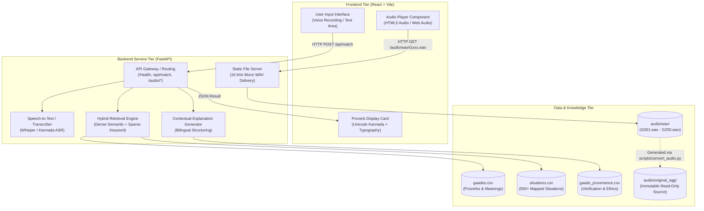
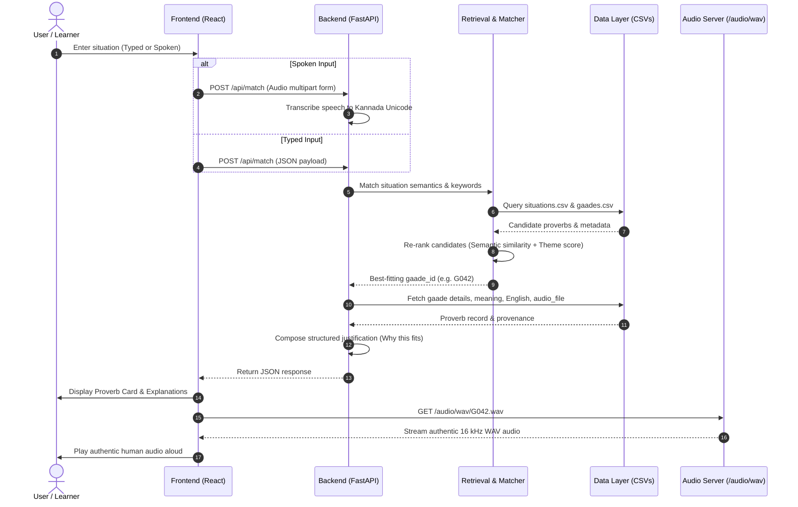
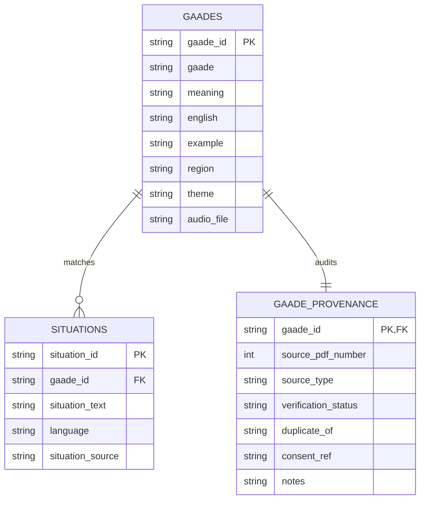

# System Architecture & Technical Specification: Gaade Kosha (ಗಾದೆ ಕೋಶ)
**Problem 2: Proverbs for Every Situation**  
**Modalapada 2.0 – Kannada Multimodal AI Hackathon**  
*Department of Computer Science & Engineering, Ramaiah Institute of Technology*

---

## 1. Executive Summary & Objective

**Gaade Kosha** (ಗಾದೆ ಕೋಶ) is an intelligent, multimodal proverb companion designed to bridge traditional Kannada cultural wisdom with modern conversational computing. In traditional Kannada households, proverbs (*ಗಾದೆಗಳು*) encapsulate centuries of ethical guidance, practical advice, and humor tailored to specific situations.

The core system workflow operates as follows:
$$\text{User Situation (Typed or Spoken)} \longrightarrow \text{Semantic Understanding} \longrightarrow \text{Gaade Matching} \longrightarrow \text{Multi-level Explanation} \longrightarrow \text{Authentic Audio Playback}$$

The system accepts a real-world dilemma or daily event described by the user (in colloquial Kannada, standard Kannada, or English), extracts the contextual intent, matches the most fitting proverb from a verified dataset of 250 proverbs, explains its meaning, provides a usage example, and plays back the proverb in the authentic human voice from the original recording.

---

## 2. System Architecture & Components

The system follows a decoupled, modular client-server architecture composed of four core tiers:



### Component Breakdown
1. **Frontend Interface (React + Vite)**:
   - Responsive web interface optimized for Kannada typography (`Noto Sans Kannada`, `Segoe UI`).
   - Dual-mode input: typed text query and in-browser audio capture (via Web Audio API / MediaRecorder).
   - Card layout presenting:
     - Canonical Kannada proverb in prominent script (`ಗಾದೆ`).
     - Kannada meaning (`ಅರ್ಥ / ವಿವರಣೆ`).
     - English translation & essence.
     - Contextual justification explaining *why* this proverb fits the user's specific dilemma.
     - Interactive audio player for streaming authentic voice recordings.

2. **Backend Engine (FastAPI + Pydantic + Uvicorn)**:
   - Asynchronous Python microservice hosting REST endpoints.
   - `/health`: Liveness and readiness monitoring.
   - `/api/match`: Accepts text or audio input, orchestrates retrieval, formats bilingual explanations, and returns structured metadata.
   - Static file delivery endpoint for serving standardized 16 kHz mono WAV audio clips.

3. **Retrieval & Matching Pipeline**:
   - **Dense Semantic Retrieval**: Vector embedding representation of situations and proverb meanings.
   - **Sparse Lexical Retrieval (BM25 / Keyword)**: Tag-based matching across themes (money, diligence, patience, family, caution) and keyword stems.
   - **Hybrid Ranker**: Combines cosine similarity with lexical overlap to ensure precise retrieval even for dialectal or brief inputs.

4. **Audio Management Pipeline**:
   - `audio/original_ogg/`: Immutable, read-only directory linking directly to original Opus recordings (`1.ogg` .. `250.ogg`).
   - `audio/wav/`: Standardized target audio format (16 kHz, single-channel mono, 16-bit PCM WAV) named uniformly as `G001.wav` .. `G250.wav` to strictly comply with Modalapada 2.0 hackathon rules.

---

## 3. End-to-End Data Flow

The lifecycle of an interaction follows an explicit sequence:



---

## 4. Comprehensive CSV Data Schemas

All text datasets are encoded in UTF-8 Unicode. Proverb identifiers use the stable, zero-padded `G001` to `G250` convention, exactly aligning with the numbers assigned in `Kannada_Gaadegalu_Revised_1_to_250.pdf`.

### 4.1. `gaades.csv`
Primary repository of Kannada proverbs, core semantic explanations, and associated metadata.

| Column Name | Data Type | Nullable | Description & Constraints | Example |
| :--- | :--- | :--- | :--- | :--- |
| `gaade_id` | String | No | Unique identifier, format `G[0-9]{3}`, primary key. Equal to PDF number. | `G001` |
| `gaade` | String | No | Exact Kannada Unicode proverb text. Must never be altered or normalized. | `ಅತಿ ಆಸೆ ಗತಿ ಕೇಡು.` |
| `meaning` | String | No | Concise explanation of the proverb in Kannada. | `ದುರಾಶೆಯು ಮನುಷ್ಯನನ್ನು ಸಂಕಷ್ಟಕ್ಕೆ ಗುರಿಮಾಡುತ್ತದೆ.` |
| `english` | String | No | Meaning, translation, and cultural essence in English. | `Too much greed leads to complete ruin and trouble.` |
| `example` | String | No | Practical real-world usage scenario in Kannada. | `ಲಾಭದ ಆಸೆಗೆ ಬಿದ್ದು ಹಣವನ್ನೆಲ್ಲಾ ಕಳೆದುಕೊಂಡಾಗ ಈ ಗಾದೆ ಬಳಸಲಾಗುತ್ತದೆ.` |
| `region` | String | No | Region or dialect of origin. If unconfirmed, set to literal `"UNVERIFIED"`. | `ಮೈಸೂರು / ಮಂಡ್ಯ` |
| `theme` | String | No | Primary cultural theme (e.g., money, work, relationships, patience, greed, time, wisdom). | `greed` |
| `audio_file` | String | No | Relative path to standardized 16 kHz mono WAV file. | `audio/wav/G001.wav` |

### 4.2. `situations.csv`
Mapping of realistic situations and conversational contexts to proverbs, powering the semantic matching engine. Each proverb must have at least 2 distinct situations.

| Column Name | Data Type | Nullable | Description & Constraints | Example |
| :--- | :--- | :--- | :--- | :--- |
| `situation_id` | String | No | Unique identifier, format `S[0-9]{3}_[1-9]`, primary key. | `S001_1` |
| `gaade_id` | String | No | Foreign key referencing `gaades.csv(gaade_id)`. | `G001` |
| `situation_text` | String | No | Contextual description of the dilemma, action, or life scenario. | `ಒಬ್ಬ ವ್ಯಾಪಾರಿ ಹೆಚ್ಚು ಲಾಭ ಪಡೆಯಲು ಎಲ್ಲಾ ನಿಯಮಗಳನ್ನು ಮುರಿದು ನಷ್ಟ ಅನುಭವಿಸಿದನು.` |
| `language` | String | No | Language code of the situation: `kn` (Kannada) or `en` (English). | `kn` |
| `situation_source` | String | No | Origin classification: `pdf_example`, `synthetic_elder_interview`, `team_curated`, or `hackathon_benchmark`. | `pdf_example` |

### 4.3. `gaade_provenance.csv`
Rigorous audit trail tracking source heritage, verification state, consent, and duplicate relationships.

| Column Name | Data Type | Nullable | Description & Constraints | Example |
| :--- | :--- | :--- | :--- | :--- |
| `gaade_id` | String | No | Foreign key referencing `gaades.csv(gaade_id)`. | `G001` |
| `source_pdf_number`| Integer | No | Original entry index (1–250) in source PDF. | `1` |
| `source_type` | Enum | No | Strict enum: `existing_collection_pdf`, `newly_drafted`, or `team_collected_from_elder`. | `existing_collection_pdf` |
| `verification_status`| Enum | No | Strict enum: `unverified`, `proofread_by_team`, or `elder_verified`. | `proofread_by_team` |
| `duplicate_of` | String | Yes | Blank if canonical. If duplicate of earlier entry, references `Gxxx`. | `""` |
| `consent_ref` | String | No | Consent form identifier in `docs/consent/`, or `"UNVERIFIED"` if legacy. | `UNVERIFIED` |
| `notes` | String | Yes | Historical notes, orthographic remarks, or revision documentation. | `Standard proverb from initial 1-200 revision list.` |

### Entity-Relationship Diagram



---

## 5. Open Risks & Mitigation Strategies

### Risk 1: Corrupted / Incomplete PDF Text Layer
* **Symptom**: Inspection of `Kannada_Gaadegalu_Revised_1_to_250.pdf` reveals that Kannada ligatures (ottuaksharas) and certain vowel signs extract as empty whitespace or disjointed Unicode codepoints due to non-standard CID font encodings.
* **Impact**: Direct text scraping yields incomplete proverbs, corrupting Kannada text integrity and violating Global Rule 2.
* **Mitigation Strategy**:
  1. PDF page rasterization: Convert all 26 pages of the revised PDF into lossless 300 DPI PNG images stored in `data/raw/pdf_pages/page_001.png` .. `page_026.png` using pure Python `pymupdf` (rendering engine `fitz`).
  2. Multi-pass extraction: Combine PyMuPDF text stream extraction with vision-based OCR verification.
  3. Ground-truth validation: Cross-verify extracted lines against the four-part sub-collections (`Kannada_Gaadegalu_1_of_4.pdf` through `4_of_4.pdf`) and generate a discrepancy log in `data/reports/pdf_extraction_audit.json`.

### Risk 2: Duplicate Gaades Across the 250 Entries
* **Symptom**: The revised PDF notes "8 ಬದಲಾವಣೆಗಳು" (8 replacements). Traditional collections often carry variant dialect spellings of identical proverbs (e.g., *ಹಾಸಿಗೆ ಇದ್ದಷ್ಟು ಕಾಲು ಚಾಚು* vs *ಹಾಸಿಗೆ ಇದ್ದಷ್ಟೇ ಕಾಲು ಚಾಚು*).
* **Impact**: Duplicate proverbs skew retrieval metrics and confuse semantic ranking models.
* **Mitigation Strategy**:
  1. Automated duplicate screening: An automated script computes string Levenshtein distance, normalized character n-grams, and semantic sentence cosine similarities across all 250 entries.
  2. Explicit provenance mapping: Duplicates are not silently discarded; instead, they are formally registered in `gaade_provenance.csv` with `duplicate_of: Gxxx` pointing to the canonical entry.
  3. Comprehensive duplicate audit report stored at `data/reports/duplicate_analysis_report.json`.

### Risk 3: Unverified Entries 201–250 & Provenance Integrity
* **Symptom**: Entries 1–200 derive from the established collection, whereas entries 201–250 are new additions ("50 ಹೊಸ ಸೇರ್ಪಡೆಗಳು"). Under Global Rule 3, elder names, collection locations, consent records, and regions must never be fabricated.
* **Impact**: Risk of inaccurate dialect labeling or fabricated oral history metadata.
* **Mitigation Strategy**:
  1. Strict literal `"UNVERIFIED"` default: All newly drafted or unverified entries receive `region: "UNVERIFIED"`, `consent_ref: "UNVERIFIED"`, and `verification_status: "unverified"`.
  2. Proofreading tier: Entries proofread by the hackathon team are explicitly marked `verification_status: "proofread_by_team"`, reserving `elder_verified` exclusively for entries accompanied by signed consent documentation in `docs/consent/`.

### Risk 4: Audio-to-ID Mapping and Audio Format Compliance
* **Symptom**: The raw recordings provided are Opus-encoded OGG files (`1.ogg` through `250.ogg`, 48 kHz, mono). Modalapada 2.0 evaluation guidelines (Slides 7 and 16) require:
  - Audio Format: **16 kHz, single-channel (mono) WAV**.
  - File Naming: Stable zero-padded ID convention (`G001.wav` .. `G250.wav`).
* **Impact**: Direct consumption of raw OGG files may fail automated hackathon grading checks expecting 16 kHz WAV.
* **Mitigation Strategy**:
  1. Read-only preservation: Original OGG files in `audio/original_ogg/` are treated as strictly immutable and read-only (Global Rule 4).
  2. Idempotent transcoding: A dedicated batch script (`scripts/convert_audio.py`) processes each `{i}.ogg` using `ffmpeg` to produce standard 16 kHz 16-bit PCM mono WAV files in `audio/wav/G{i:03d}.wav`.
  3. Audio integrity verification: `scripts/verify_audio.py` runs `ffprobe` over all 250 WAV files to confirm duration, sample rate (16000 Hz), channels (1), and audio health, saving results to `data/reports/audio_conversion_report.json`.

---

## 6. Directory Layout & Repository Standard

```text
gaade-kosha/
├── data/
│   ├── raw/
│   │   └── pdf_pages/               # Rasterised 300 DPI PDF page images
│   ├── gaades.csv                   # Core proverb collection (G001 - G250)
│   ├── situations.csv               # 500+ context situations mapped to gaades
│   ├── gaade_provenance.csv         # Verification status, source, consent refs
│   └── reports/                     # Extraction, duplicate, and audio reports
├── audio/
│   ├── original_ogg/                # Read-only source recordings (1.ogg - 250.ogg)
│   └── wav/                         # 16 kHz mono WAV files (G001.wav - G250.wav)
├── backend/
│   ├── app/
│   │   ├── __init__.py
│   │   └── main.py                  # FastAPI application & health check
│   └── tests/
│       ├── __init__.py
│       └── test_health.py           # Pytest health and root endpoint test
├── frontend/
│   ├── public/                      # Static assets & favicon
│   ├── src/
│   │   ├── App.jsx                  # React application skeleton
│   │   ├── main.jsx                 # React root entry
│   │   └── index.css                # Typography & styling
│   ├── index.html                   # HTML5 page skeleton
│   ├── vite.config.js               # Vite configuration with API proxy
│   └── package.json                 # Frontend dependencies (React 18, Vite 6)
├── scripts/                         # Conversion, validation, and rasterization scripts
├── docs/
│   ├── consent/
│   │   └── CONSENT_TEMPLATE.md      # Elder voice consent protocol & form
│   └── architecture.md              # Technical specification & system design
├── requirements.txt                 # Backend Python dependencies
├── package.json                     # Root npm script runner
├── .gitignore                       # Git ignore rules for node_modules, caches
└── README.md                        # Project overview and onboarding instructions
```

